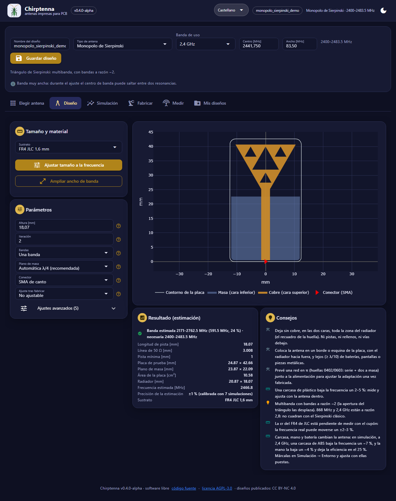
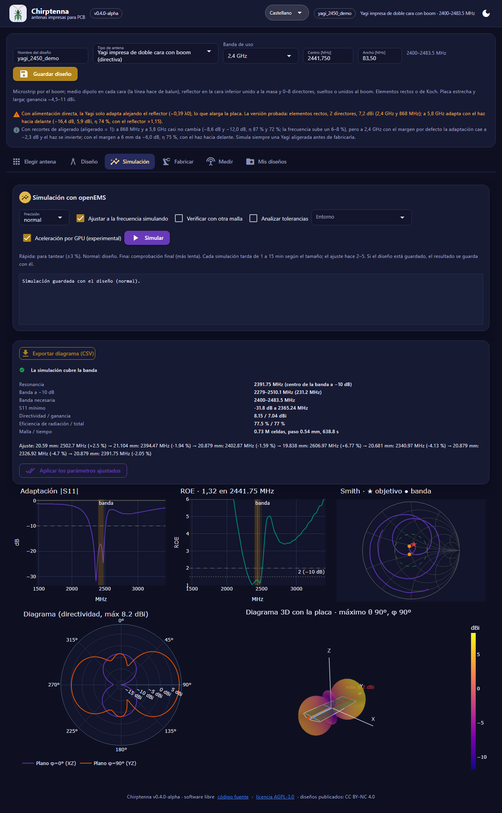
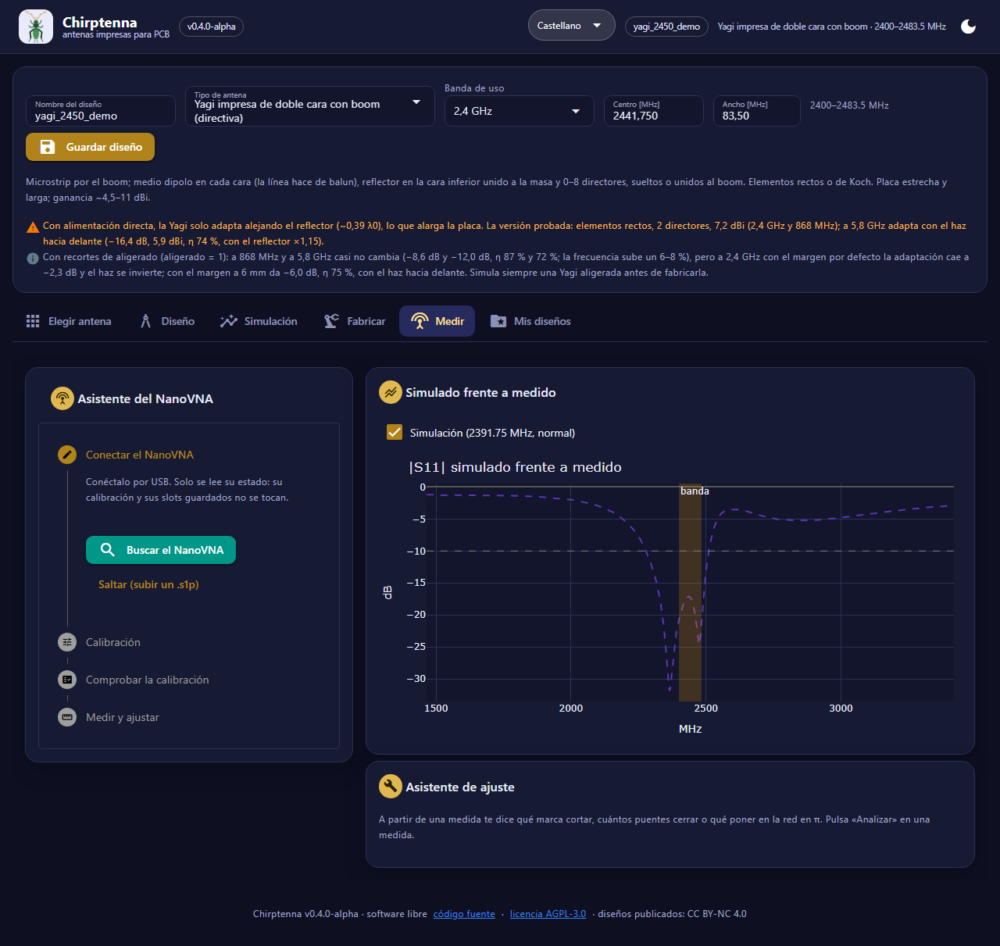

# Manual de Chirptenna

*Versión alpha. Instalación: [INSTALAR.md](INSTALAR.md). Este manual está en castellano, como la interfaz.*

Este manual explica cómo usar Chirptenna de principio a fin: diseñar una antena, simularla, mandarla a
fabricar, medirla y **ajustarla** una vez fabricada, con marcas de corte, puentes y la **red en π**.

> **Antes de nada:** Chirptenna está en alpha y casi todo lo que calcula está validado **solo en simulación**
> (hasta ahora se han medido los cupones de εr y dos antenas: un monopolo de Sierpinski, a +1 % de lo simulado,
> y una Yagi, a +3,6 %). La
> placa real casi nunca sale exactamente en la frecuencia: el FR4 varía de un lote a otro, y la caja, la
> batería y el cable la desplazan. Por eso las antenas llevan opciones de ajuste y por eso **hay que medir**
> antes de fiarse.

**Índice**

0. [Primeros pasos: tu primera antena en 10 minutos](#primeros-pasos-tu-primera-antena-en-10-minutos)
1. [Conceptos en 5 minutos](#1-conceptos-en-5-minutos)
2. [El flujo de trabajo](#2-el-flujo-de-trabajo)
3. [La barra del diseño](#3-la-barra-del-diseño)
4. [Pestaña Diseño](#4-pestaña-diseño)
5. [Pestaña Simulación](#5-pestaña-simulación)
6. [Pestaña Fabricar](#6-pestaña-fabricar)
7. [Montar la placa](#7-montar-la-placa)
8. [Pestaña Medir](#8-pestaña-medir)
9. [Ajustar la antena fabricada](#9-ajustar-la-antena-fabricada)
10. [La red en π a fondo](#10-la-red-en-π-a-fondo)
11. [Pestaña Mis diseños](#11-pestaña-mis-diseños)
12. [Qué antena elegir](#12-qué-antena-elegir)
13. [Problemas frecuentes](#13-problemas-frecuentes)
14. [Integrar la antena en tu placa](#14-integrar-la-antena-en-tu-placa)
15. [Idioma, tema, GPU y versión web](#15-idioma-tema-gpu-y-versión-web)
16. [Glosario](#16-glosario)

---

## Primeros pasos: tu primera antena en 10 minutos

Si nunca has usado Chirptenna, haz este recorrido una vez; el resto del manual explica cada paso a fondo.

1. **Abre el programa:** doble clic en el acceso directo **Chirptenna** del escritorio (o en `iniciar.bat`). Se abre el
   navegador en `http://localhost:8080`. Mantén abierta la ventana negra mientras lo uses. Si no lo has instalado,
   mira [INSTALAR.md](INSTALAR.md).
2. **Elige la antena.** Sale la pestaña **Elegir antena**. Para un nodo Meshtastic de 868 MHz, pincha **Monopolo de
   Koch**; para 2,4 GHz, **Monopolo de Sierpinski**. Los tipos con la etiqueta **Validada** son los que se han
   comprobado en simulación; los de **Experimental** tienen problemas conocidos.

   

3. **Elige la banda** en la barra de arriba (868 MHz, 915 MHz, 2,4 GHz…). El tamaño se calcula solo. Si tu canal no está
   en la lista, elige **Otra** y escribe el centro y el ancho.
4. **Mira el resultado** en **Diseño**: el dibujo de la placa, la banda estimada y los consejos. Pulsa **Ajustar tamaño a
   la frecuencia** si cambias algo.

   

5. **(Opcional) Simula** en la pestaña **Simulación** con **Simular**. Tarda de 1 a 15 minutos y te da S11, Smith, ganancia
   y diagrama. Si la banda no queda cubierta, el programa lo dice en rojo.
6. **Guarda el diseño** (botón **Guardar diseño** de la barra) y, en **Fabricar**, pulsa **Exportar KiCad + Gerber + DXF**. Sube el zip a
   JLCPCB (2 capas, FR4 de 1,6 mm).
7. **Cuando llegue la placa:** suelda el SMA, mide con el NanoVNA en **Medir** y ajusta con las marcas de corte o la red en π
   ([capítulos 7 a 10](#7-montar-la-placa)).

> **Si solo quieres probar**, la [versión web](#15-idioma-tema-gpu-y-versión-web) no necesita instalar nada: diseña y
> descarga los archivos de KiCad, sin simulación.

---

## 1. Conceptos en 5 minutos

- **Frecuencia de resonancia.** La frecuencia a la que la antena «encaja» con la radio. Depende sobre todo
  de su longitud: **más larga, frecuencia más baja**; más corta, más alta.
- **S11 (pérdida de retorno), en dB.** Cuánta potencia rebota en la antena y vuelve a la radio. Cuanto más
  negativo, mejor:

  | S11 | ROE | Potencia que entra en la antena | Valoración |
  |---|---|---|---|
  | −3 dB | 5,8 | 50 % | Mala |
  | −6 dB | 3,0 | 75 % | Floja |
  | **−10 dB** | **1,9** | **90 %** | **Buena: el criterio habitual** |
  | −15 dB | 1,4 | 97 % | Muy buena |
  | −20 dB | 1,2 | 99 % | Excelente (pasado este punto, mejorar no se nota) |

- **ROE (VSWR).** Lo mismo que S11 con otra escala: 1 es perfecto; por debajo de 2 está bien.
- **Banda a −10 dB.** El tramo de frecuencias en el que S11 está por debajo de −10 dB. Tu banda de uso
  (por ejemplo, 869,4–869,65 MHz en Meshtastic EU) tiene que caer **dentro**, con algo de margen.
- **Impedancia (Z = R + jX).** La radio y el cable son de **50 Ω**. La antena ideal presenta R = 50 Ω y
  X = 0. Si R se aleja de 50 o X no es cero, parte de la potencia rebota.
  - X positiva = la antena se comporta como una **bobina** (inductiva), típico si es **demasiado larga**.
  - X negativa = se comporta como un **condensador** (capacitiva), típico si es **demasiado corta**.
- **Carta de Smith.** Un dibujo de la impedancia en cada frecuencia. El **centro** es 50 Ω perfecto, la
  mitad de **arriba** es inductiva y la de **abajo**, capacitiva. Chirptenna dibuja el círculo de ROE 2
  (dentro de él = S11 < −10 dB), los bordes de tu banda (●) y el objetivo (★). Ajustar una antena es
  llevar la ★ al centro.
- **Ganancia (dBi)** y **eficiencia (η).** La ganancia dice cuánto concentra la antena en su mejor
  dirección. La eficiencia, qué parte de la potencia que entra se radia de verdad: el resto se pierde en
  calor, sobre todo en el FR4. Una antena puede estar perfectamente adaptada (S11 −20 dB) y aun así radiar
  poco si su η es baja.

---

## 2. El flujo de trabajo

Las pestañas siguen el orden del trabajo:

```
Diseño ──► Simulación ──► Fabricar ──► (JLC) ──► montar ──► Medir ──► ajustar ──► Medir…
 tipo,      openEMS:       reglas,                SMA y       NanoVNA    cortar,
 banda,     S11, Smith,    Gerber,                componentes o .s1p     puentes,
 tamaño     diagrama       serigrafía                                    red en π
```

- **Simular es opcional.** El tamaño inicial sale de fórmulas calibradas con simulaciones anteriores y
  suele quedar a un 0–3 % de lo que da la simulación. Simular sirve para confirmar la banda, ver el
  diagrama de radiación y afinar antes de pagar la fabricación.
- **Guarda el diseño** (botón **Guardar diseño**). Cada diseño guarda en su carpeta la simulación, los
  archivos de fabricación y las medidas, para poder compararlos después.

---

## 3. La barra del diseño

Al abrir el programa sale la pestaña **Elegir antena**: los tipos agrupados por uso (nodo portátil, enlace fijo, sin
plano de masa y experimentales), cada uno con un dibujo, una descripción y su estado: **Validada** (en simulación),
**Pendiente de validación** o **No funciona**. Al pinchar uno se dimensiona para la banda elegida y se pasa a Diseño.

La barra está siempre arriba:

| Campo | Qué es |
|---|---|
| **Nombre del diseño** | El nombre de la carpeta en *Mis diseños*. Cambiarlo y guardar crea un diseño nuevo (sirve para hacer variantes) |
| **Tipo de antena** | Ver [qué antena elegir](#12-qué-antena-elegir). La lista muestra la descripción y el estado de cada tipo. Bajo la barra aparecen los **problemas conocidos** del tipo: léelos |
| **Banda de uso** | 433, 868, 915 ISM, 1,2 GHz radioaficionado, GPS L1, Iridium, 2,4 o 5,8 GHz rellenan el centro y el ancho (solo 868 MHz y 2,4 GHz están simuladas; GPS e Iridium usan polarización circular y la antena es lineal, pierdes ~3 dB; 5,8 GHz: el FR4 pierde mucho; el Hilbert y la quasi-Yagi de Koch no se pueden fabricar ahí). Con **Otra** los pones a mano (p. ej. 915 MHz en América) |
| **Centro [MHz]** | La frecuencia objetivo. Para Meshtastic, pon la frecuencia real de tu canal (en EU_868 con LongFast, 869,525 MHz; mírala en la app de Meshtastic) |
| **Ancho [MHz]** | El ancho que tiene que cubrir la antena. Pon el de tu canal o tu banda; el programa añade margen |

> **Truco para Meshtastic:** centra la antena en tu canal, no en el centro de la banda de 868 MHz. Así,
> con los 5–10 MHz de banda de un monopolo, te queda margen a los dos lados para lo que desplacen la caja y
> la batería.

---

## 4. Pestaña Diseño

La pestaña tiene tres zonas: a la izquierda el **tamaño y el material** y los **parámetros**; a la derecha el
**dibujo de la placa** (contorno, masa, cobre y conector); y debajo el **resultado** y los **consejos**.


Sobre el dibujo hay un conmutador **2D / 3D**. La vista **3D** muestra la placa con su grosor (FR4 translúcido), el cobre de la cara superior
en naranja y el de la inferior en azul, las vías, el conector y, en las antenas con reflector, el reflector a su distancia real. Se gira y se
acerca con el ratón. Si la placa es muy larga el grosor se dibuja **exagerado** (el título lo dice) para que se vea. En las antenas **modulares**
(la colineal) aparece la casilla **Explosionada**: dibuja cada placa a fabricar por separado, en orden y con su cantidad («módulo 1/2»,
«módulo 2/2»…), con las lengüetas de encaje; sin marcarla, la antena armada con las uniones señaladas en rojo. En **Simulación**, el diagrama
de radiación se dibuja también en 3D sobre la placa, con la dirección del máximo.

### Tamaño y material

- **Sustrato.** El material y el grosor de la placa: FR4 de JLC de 1,6 / 1,2 / 1,0 / 0,8 mm, Rogers
  RO4350B, cuatro PTFE («teflón») de 0,65 / 0,76 / 0,9 / 1,52 / 1,65 mm (ZYF255DA, ZYF265D, ZYF300CA-C y ZYF300CA-P; los
  grosores de 0,76 y 1,52 mm están sin confirmar en JLC), poliimida flex de 25 / 50 µm, o **Personalizado…** para cualquier otro
  material: eliges esa opción y escribes la εr, la tanδ y el grosor que da el fabricante (εr de 1 a 20, tanδ hasta 0,2 y grosor
  de 0,02 a 6 mm). Sirve para un Rogers o un PTFE que no esté en la lista; el diseño guarda esos valores. El FR4 de 1,6 mm es el más
  barato y el que se ha usado para validar. El RO4350B y el PTFE pierden mucho menos (más eficiencia, sobre todo en parches y
  arrays), pero son más caros y no ensanchan la banda por sí solos. El **flex** no tiene impedancia controlada y una línea de
  50 Ω saldría de ~0,1 mm: úsalo con los tipos que llevan el coaxial soldado en la antena (dipolo, bowtie, J-pole). Con PTFE o flex
  elige las reglas «JLC alta frecuencia y flex (0,1 mm)» en Fabricar; se piden en los servicios de alta frecuencia y de flex de JLC.
  **4 capas:** «FR4 JLC 4 capas 1,6 mm» solo vale con la antena integrada (IFA o monopolos): la masa va en la capa interna 1, a 0,21 mm
  de la pista, así que la línea de 50 Ω mide ~0,4 mm y la simulación es ~10 veces más lenta (IFA de 30 × 50 mm: 2418 MHz, 205 MHz de banda). Su εr (4,4) sale de una transcripción de la
  calculadora de JLC: compruébala en su calculadora antes de fabricar. Con 4 capas usa el conector «Pad de RF» (el pad del SMA de canto sobre 0,2 mm de dieléctrico no está modelado).
- **Ajustar tamaño a la frecuencia.** Recalcula las medidas para que la antena resuene en el centro
  elegido. **Púlsalo siempre que cambies de banda, de tipo o de sustrato.** Respeta las medidas que hayas
  fijado a mano.
- **Ampliar ancho de banda.** Si la banda estimada no cubre el ancho pedido, ensancha la pista (monopolos y
  Yagi) o el parche, manteniendo la frecuencia. Te dice si ya cubre la banda o hasta dónde ha llegado.

### Parámetros

Cambian según el tipo. Primero salen los **básicos**; el resto está plegado en **Ajustes avanzados** (márgenes,
huecos, anchos de pista, opciones finas del ajuste…), y normalmente no hace falta tocarlos. Cada parámetro tiene un
botón **?**: púlsalo para ver qué hace. Los más habituales:

- **Medidas de la antena** (largo, ancho de pista, iteración del fractal…). La **iteración** de un fractal la hace más compacta, pero suele estrechar la banda y bajar
  la eficiencia.
- **Plano de masa** (monopolos): un plano de masa de **λ/4 o más** es lo ideal. Uno más corto encoge la
  placa, pero obliga a alargar el radiador y hace la antena más sensible a lo que se conecte detrás.
- **Conector:** SMA de canto (para probar y medir) o IPEX/U.FL (para integrarla). Con IPEX la adaptación
  aún está en revisión: lee los problemas conocidos. «Pad de RF» no lleva conector: la línea de 50 Ω acaba en un
  pad con dos vías de masa al lado, para llegar a él con la línea de tu producto (no hay modelo del chip: la
  simulación es la misma que con SMA; la red en π, si la activas, va junto al pad).
- **Ajuste tras fabricar** (monopolos, parches, J-pole, quasi-Yagi). Ponlo en **Ajustable** para una
  primera tirada: añade las [opciones de ajuste](#9-ajustar-la-antena-fabricada) (sobrelargo con marcas,
  tramos con puentes y red en π). Cuando tengas una versión ya ajustada y medida, puedes fabricar la
  definitiva sin ellas.
- **Aligerado** (Yagi y panel): ventanas sin FR4 para que pese menos. Quitar FR4 sube un poco la frecuencia y
  puede estropear la adaptación (la Yagi aligerada de 2,4 GHz deja de adaptar con el margen por defecto): simúlala
  antes de fabricar.
- **Bandas** (Sierpinski, J-pole recta e IFA): con **Dos bandas** la antena cubre la banda que elijas arriba
  (**868 o 915 MHz**) y además 2,4 GHz. Elige siempre la banda **baja** en la barra del diseño. El Sierpinski es el
  más fiable; la J-pole y la IFA de dos bandas son experimentales.

- **Colineal modular** (colineal de dipolos, parámetro **Construcción**): en lugar de una placa larga, una placa por
  dipolo, que se unen por el canto. **Número de dipolos** (de 2 a 4 en FR4) fija la ganancia: en simulación a 2,4 GHz, 4
  dipolos dan 4,0 dBi con η 61 % y más no suben la ganancia (la línea de λg en FR4 se la come). Al exportar salen tres
  placas: la de **inicio** (con el SMA), el **módulo** (igual para todos los intermedios) y una **final** corta, además de
  la cadena entera por si prefieres una sola placa. Consejos de montaje: pide N placas (1 de inicio, N−2 módulos, 1
  final), alinéalas y suelda la línea y la masa de las dos caras sobre las aperturas de máscara (4 soldaduras por unión), y
  refuerza con una pletina de FR4 pegada o un tubo de PVC. **Encaje entre módulos:** *Lengüetas y ranuras* (por defecto) alinean las placas (dos lengüetas de 3 mm en el canto de arriba que entran en las ranuras del siguiente, con 0,15 mm de holgura) para que no se desplacen ni giren al soldar; *Cola de milano* además las sujeta (se juntan en el plano de la placa y se bajan una sobre otra); *Canto plano* las deja sin muescas. JLC fresa las ranuras (ancho mínimo 1 mm). **La unión soldada no está simulada ni medida**: mide la
  antena unida. A 868 MHz, donde la placa entera mide ~84 cm, es la forma práctica de fabricarla.

### Resultado y consejos

- **Resultado (estimación):** tamaño de la placa, frecuencia estimada, banda, ganancia aproximada y
  avisos. Son estimaciones; la simulación las precisa.
- **Consejos:** recomendaciones para ese diseño concreto (pista demasiado fina, plano de masa corto, banda
  justa…).

---

## 5. Pestaña Simulación

Simula la antena con **openEMS** (un simulador electromagnético de onda completa, FDTD) y, si tienes MATLAB con la
Antenna Toolbox, también con MATLAB.



1. **Motor:** *openEMS* (el de siempre), *MATLAB (Antenna Toolbox)* u *openEMS + MATLAB*. El selector solo se
   activa si el programa encuentra MATLAB con la Antenna Toolbox instalada (o la ruta de `matlab.exe` en la variable
   `MATLAB_EXE`); si no, queda desactivado y su ayuda dice por qué.
   - **MATLAB** usa el método de momentos de la Antenna Toolbox: es más aproximado que openEMS, no ajusta la frecuencia,
     no calcula ganancia ni eficiencia y no usa la GPU. Con él quedan desactivadas las demás opciones. Tarda de uno a unos
     minutos (el dipolo, 1 min) y solo vale para placas sencillas: cobre en las dos caras, FR4 de dos capas y alimentación en
     el borde. No sirve para paneles, antenas con reflector, vías, entorno ni la colineal modular, y lo avisa.
   - **openEMS + MATLAB** simula con openEMS (con su ajuste, si lo marcas) y luego con MATLAB la antena ya ajustada. La
     gráfica de S11 superpone las dos curvas y debajo sale la diferencia de frecuencia y de directividad: dentro de un 5 % y
     1 dB se considera que coinciden. **Es un contraste independiente, no una medida**: si los dos motores discrepan, desconfía
     de los dos y mide la placa. Con la malla por defecto MATLAB sale entre un 3 y un 9 % alto en frecuencia en el dipolo y
     el monopolo; en un parche la directividad de MATLAB no es fiable.
2. **Precisión:**
   - **rápida** para tantear (±3 %);
   - **normal** para diseñar;
   - **fina** para la comprobación final, más lenta.
3. **Ajustar a la frecuencia simulando:** si está marcado, simula, corrige el tamaño y repite (2–5
   simulaciones) hasta que el centro de la banda a −10 dB cae en el objetivo. Si no, hace una sola.
4. **Verificar con otra malla:** repite la simulación final con el paso de malla un 15 % menor y un 15 % mayor
   (tarda el triple) y avisa si el resultado cambia: más de un 5 % de frecuencia, o más de 5 dB de S11 cuando
   alguno de los dos queda por encima de −10 dB. Un aviso significa que **un solo punto no es de fiar** y hay que
   medir la antena. Se hace siempre con dos bandas, paneles y arrays, que son los que más dependen de la malla.
5. **Analizar tolerancias:** simula además con la εr dentro de su tolerancia (±5 % en FR4, ±1,5 % en los PTFE de JLC), el grosor un ±10 % y el cobre ±0,05 mm
   (6 simulaciones más) y dice si la banda sigue cubierta: «cubre con margen», «justo» o «no cubre: necesita
   ajuste tras fabricar». Un monopolo de banda ancha cubre; un parche rectangular (~36 MHz de banda) no.
6. **Entorno:** simula también con una carcasa de ABS, una batería metálica o una mano cerca (2 simulaciones más)
   y dice cuánto cambian la frecuencia y la eficiencia.
7. **Simular.** El registro muestra el progreso. Puedes seguir usando el resto de la interfaz.

**Cuánto tarda:** de 1 a 15 minutos cada simulación en un monopolo de 2,4 GHz. A 868 MHz, con pistas finas,
o en arrays y paneles, puede llegar a horas. Los resultados quedan en caché: repetir la misma geometría es
instantáneo.

### Cómo leer los resultados

- **Calcular red de adaptación:** con las antenas que llevan la red en π (monopolos con **Ajuste tras fabricar** = «Ajustable»), tras
  simular sale este botón. Calcula **por circuito** (sin otra simulación) la red en L de valores E24 que lleva la impedancia simulada
  a 50 Ω, y da las piezas (Z1 en serie y la derivación a masa), el S11 resultante, el peor caso con componentes ±5 % y la banda que se
  mantiene. Monta solo esas dos piezas y deja la otra derivación sin montar. Sin hacer: comprobarlo con una simulación con los componentes puestos.
- **Exportar diagrama (CSV):** guarda el diagrama simulado (θ, φ, directividad y ganancia en dBi) en la carpeta `fabricacion` del diseño y lo descarga.
- **S11** y **ROE**: la curva tiene que bajar de −10 dB (o de ROE 2) en toda tu banda (zona sombreada).
- **Carta de Smith:** cuanto más cerca del centro pase la ★, mejor. Si la curva da un **bucle** cerca del
  centro, la banda es más ancha.
- **Diagrama de radiación:** cortes polares y vista 3D con la placa dibujada dentro. Mira hacia dónde
  apunta el máximo (la flecha). En las directivas (Yagi, panel) debe apuntar **hacia delante**.
- **Ganancia y eficiencia:** una η por debajo del 50 % indica pérdidas grandes en el FR4. Si sale por debajo
  del 10 %, el programa avisa: algo en el modelo no está bien.

Si el diseño estaba guardado y no lo has cambiado, el resultado se guarda con él. Si la simulación ajustó el
tamaño, pulsa **Aplicar los parámetros ajustados** para pasarlos al diseño.

---

## 6. Pestaña Fabricar


### Comprobaciones de fabricación

Elige las **reglas del fabricante** (JLC estándar, JLC mínimo o holgado). La lista avisa de pistas o huecos
por debajo de lo que el fabricante puede hacer, de cobre demasiado cerca del borde y de los **problemas
conocidos** del tipo de antena.

### Exportar

**Exportar KiCad + Gerber + DXF** guarda el diseño y crea en su carpeta `fabricacion`:

| Archivo | Para qué |
|---|---|
| **Gerber para JLC (.zip)** | Se sube tal cual a JLCPCB (u otro fabricante). Lleva cobre, máscara, serigrafía, contorno y taladros |
| **Placa de prueba KiCad (.kicad_pcb)** | La placa completa con su conector, para abrirla o modificarla en KiCad |
| **Huella KiCad (.kicad_mod)** | Solo la antena, para meterla dentro de **tu propia placa** |
| **DXF** | El dibujo para EasyEDA u otros programas |
| Reflector (panel) | Una segunda placa (o chapa) que hace de reflector |

Al acabar se pasa el **DRC de KiCad**. Debe salir sin errores.

**Informe en PDF** crea `<diseño>_informe.pdf` en la misma carpeta y lo descarga: portada con la vista, parámetros,
problemas conocidos y consejos y, si el diseño tiene una simulación guardada, S11, ROE, Smith, diagrama, ganancia y
eficiencia, tolerancias, entorno y red de adaptación. Sale en el idioma de la interfaz.

**Al pedir en JLCPCB:** sube el zip de Gerber y elige 2 capas, el **material y el grosor del sustrato que
pusiste en el diseño** (FR4 de 1,6 mm por defecto), cualquier color de máscara y el acabado que quieras
(HASL o ENIG). El grosor importa: cambiarlo desplaza la frecuencia y estropea la línea de 50 Ω.

> **Si vas a meter la antena en tu placa con la huella:** respeta la **zona libre** sin cobre ni componentes
> alrededor del radiador, y usa la misma línea de 50 Ω y el mismo grosor de placa. El plano de masa de tu
> placa pasa a formar parte de la antena: en un monopolo, su tamaño cambia la frecuencia.

### Serigrafía (inscripciones)

Van en la cara de abajo, espejadas para leerse al darle la vuelta. Puedes elegir:
- el **logo de Chirptenna** (grande, pequeño o ninguno);
- el tipo y la frecuencia, el nombre del diseño, el resultado de la simulación, la licencia, la fecha;
- texto libre.

Si no cabe todo, se mantienen el logo y la primera línea. Las **marcas de corte**, «vivo»/«malla» y las
referencias de los componentes (Z1, Z2, Z3, JP…) se ponen siempre: hacen falta para ajustar.

### Carcasa 3D (STL)

La carcasa se define en **Diseño**, en la tarjeta **Carcasa 3D** (material, relleno, pared, holguras, cierre y tornillo):
así el material ya está elegido cuando llegas a Simulación, que solo muestra un resumen («PLA 100 % · pared 1,6 mm · …») y un botón
**Cambiar la carcasa**. Para verla, elige **Carcasa** en el selector de la vista (2D / 3D / Carcasa) y luego **Montada** (cerrada, con
la placa dentro), **Abierta: base + placa** (sin tapa) o **Explosionada** (base, placa y tapa separadas, con los tornillos); se
redibuja al cambiar cualquier valor. En **Fabricar**, la tarjeta **Carcasa 3D (STL)** solo genera la **base** y la **tapa** para imprimir, a la medida de la placa:
reborde de apoyo bajo los cantos, labio de encaje, cuatro orejetas en las esquinas y una abertura
para el conector. El **cierre** puede ser un tornillo autorroscante, tornillo y tuerca (la tuerca entra por debajo),
tornillo e inserto roscado de latón, o sin tornillos (la tapa se pega); tornillos M2, M2,5 o M3.
La simulación incluye las orejetas y el metal del tornillo (cabeza, caña, tuerca o inserto) y te dice cuánto mueve la
frecuencia el metal frente al mismo plástico sin él. La tapa sale boca abajo, lista para imprimir sin soportes. Ajustas el material (PLA, PETG o ABS),
la pared, la holgura lateral, el aire bajo y sobre la placa y el radio de las esquinas.
Solo vale para antenas de **una placa plana** (no para módulos, reflector ni placas en 3D).

**Un plástico cerca de la antena la baja de frecuencia** (un dipolo de 2,4 GHz resuena ~5 % más bajo dentro de una
caja de PLA de 1,6 mm). Por eso, en Simulación, la casilla **Ajustar y simular con la carcasa del diseño** pone la
carcasa alrededor de la placa y centra la antena con ella puesta; el resultado dice además cuánto habría resonado
sin la carcasa. Los valores del material son típicos de impresión con 100 % de relleno; con menos relleno la εr
efectiva baja. **Los valores de la lista son genéricos: mide cada plástico que uses** (cupón C, siguiente apartado). La tabla es a 2,4 GHz; para otra frecuencia (868 MHz) se aplica una tendencia genérica (la εr casi no cambia y la tanδ baja un ~27 % a 868 MHz) que es una suposición, no una medida; la interfaz muestra la εr y la tanδ que usa a la frecuencia de tu diseño. Hay PLA, PETG, ABS, ASA, PC, nailon (PA12 y PA6, secos; húmedos suben la εr y las pérdidas) y versiones con fibra de vidrio (GF), con valores típicos de hoja técnica (sin medir: la marca, el color y la humedad los mueven). El **Relleno (%)** baja la εr efectiva (una pared de 1,6 mm suele ser maciza). **No uses fibra de carbono (CF), grafito ni filamentos conductores o ESD**: son conductores y apantallan la antena. Si quieres los de **tu** plástico, elige «Personalizado» y escribe su εr y su tanδ, o mídelos
con el cupón C (siguiente apartado).

#### Medir el plástico con el cupón C

El **cupón C** es una placa de 100 × 100 mm con **tres stubs abiertos** (líneas de 50 Ω que acaban en circuito abierto, de 43, 59 y 86 mm) que resuenan a unos 870, 645 y 450 MHz
y en sus armónicos (hasta 2,6 GHz). Se genera con `python cupon/generar_cupon.py C` y se pide a JLC como cualquier otra. **Solo necesita S11** (un puerto), así que sirve cualquier NanoVNA,
también los normales, que llegan a 900 MHz (miden los tres modos más bajos); los de 1,5 o 2,7 GHz miden también los armónicos. El método:

1. Calibra el NanoVNA (OSL) en el conector del cupón y mide el **S11 de un stub sin muestra**: la frecuencia en que la reactancia cruza por cero hacia arriba (la resonancia) y la resistencia ahí.
2. Pon encima el plástico (una **tira plana** de 24 mm de ancho y el largo del stub, de grosor conocido) y vuelve a medir. La tira lleva **cuatro taladros M3 en las esquinas** que coinciden con otros cuatro de la placa: pasa por ellos
   tornillos de nailon (la cabeza debajo de la placa, la tuerca y una arandela de nailon encima) y apriétalos solo a mano. Así la muestra
   queda **centrada y fija** (no se mueve al apretar) y **no hay nada de plástico encima del stub**: un pisador o una placa sobre la muestra
   sube la εr aparente un 9–17 %, porque añade otro dieléctrico al campo. Nada de tornillos metálicos. Una rendija de aire de décimas de
   milímetro entre muestra y placa también falsea la εr: usa tiras planas y repite la medida volviendo a montarla para ver cuánto varía.
3. Usa el **Asistente de materiales (cupón C)** de la pestaña Medir (también desde Fabricar → Carcasa → «Medir mi plástico»).
   Te guía en cinco pasos: *Qué medir* (un plástico o el FR4 del cupón, el stub y el modo), *Preparar* (aquí generas los STL de
   las tiras de 2, 3 y 4 mm con sus cuatro taladros M3), *Medir sin muestra* y *Medir con la muestra* (sube el `.s1p` y se busca la resonancia y su resistencia,
   o escribe los valores; añade el grosor real y la rendija estimada) y *Resultado*. Da la **εr con su incertidumbre** y, con las resistencias, una **tanδ aproximada**;
   «Usar este material en la carcasa» los lleva al material Personalizado. Con «El FR4 del cupón» mides antes la εr de tu FR4 (con dos o tres stubs en el mismo modo) y la usas de base.
   La εr está validada contra openEMS 3D a ±1 % (3 % máx) para εr 2–10 y grosor 1,5–4,5 mm; fuera de ahí la interfaz avisa. La misma herramienta está en la web **Chirptenna VNA** (modo Avanzado → Asistente de materiales), que
   puede usar directamente la última medida de S11 de la página.
La tanδ de los plásticos es muy pequeña y sale de unas décimas de ohmio en la resonancia: con un NanoVNA solo se distingue por encima de ~0,03, y si la
incertidumbre es mayor que el valor, la interfaz lo dice (con plásticos de pérdidas bajas usa la de la literatura). Mide el FR4 de tu cupón antes y úsalo como referencia
(εr del sustrato del diseño). Mide también una pieza conocida (PTFE, FR4) para ver que el método da lo esperado, y repite con varias
muestras impresas: la impresión 3D es anisótropa y el valor depende del relleno y de la orientación de las capas. La simulación usa cajas de caras rectas (suelo, tapa y cuatro paredes con el hueco del conector):
no incluye esquinas redondeadas, labio, reborde ni orejetas. Mide la antena dentro de la carcasa antes de darla por buena.

---

## 7. Montar la placa

1. **Conector SMA de canto:** centra el pin en la pista de 50 Ω y suelda el pin central por arriba. Suelda
   las patas de masa **por las dos caras**: una masa mal soldada cambia la medida.
2. **Red en π:** si el diseño la lleva, la placa trae tres posiciones (huella 0603 o 0402):
   - **Z1**, en serie con la pista, con un hueco que hay que cerrar. Para la primera medida pon una
     **resistencia de 0 Ω** (o un puente de estaño);
   - **Z2** (lado del conector) y **Z3** (lado de la antena), de la pista a masa. **Déjalas vacías.**
3. **Tramos con puentes:** vienen **abiertos**. No los cierres todavía.
4. Limpia los restos de flux con alcohol isopropílico: a 2,4 GHz, una capa gruesa de flux se nota.

---

## 8. Pestaña Medir

### Con un NanoVNA (asistente)



El asistente tiene cuatro pasos:

1. **Conectar el NanoVNA.** Pulsa **Buscar el NanoVNA**. Solo se lee su estado: su calibración y sus slots
   guardados no se tocan nunca.
2. **Calibración.** Elige una calibración guardada o **Calibrar ahora**:
   - Calibra **al final del latiguillo que vayas a usar con la antena**. Ahí queda el plano de medida.
   - El rango que propone va de 0,6 a 1,4 veces la frecuencia del diseño. 301 puntos es buen compromiso.
   - Sigue las instrucciones: **OPEN** (nada conectado), **SHORT** (cortocircuito) y **LOAD** (carga de
     50 Ω), cada uno en el extremo del latiguillo. Si pones el estándar equivocado, el programa lo detecta y
     avisa.
   - **Guardar calibración** la deja en el PC para otras veces. Vale mientras uses el mismo latiguillo y el
     mismo rango.
3. **Comprobar la calibración.** Pon la **carga de 50 Ω** y pulsa **Comprobar**. Bien calibrado, |S11|
   queda por debajo de **−30 dB**. Si no, repite la calibración.
4. **Medir y ajustar.** Conecta la antena:
   - Escribe una **etiqueta** que diga qué has cambiado («sin cortar», «Z1 3,3 nH»…) y pulsa **Medir y
     guardar**. La medida se guarda en el diseño y se superpone a la simulación.
   - El modo **En vivo** repite la medida cada pocos segundos alrededor de la banda, **sin guardarla**, y
     muestra la resonancia, el S11 en el objetivo y la primera recomendación. Sirve para ir cortando poco a
     poco. **Guardar esta medida** guarda la última.

### Con otro analizador

Mide con su programa, exporta un **`.s1p`** (Touchstone de 1 puerto) y súbelo en **…o sube un .s1p**.
También puedes saltar el NanoVNA con **Saltar (subir un .s1p)**.

### Cómo medir bien

- Mide la antena **en las condiciones de uso**: dentro de su caja, con la batería y la placa del nodo
  conectadas si van pegadas. La caja de plástico suele **bajar** la frecuencia un 1–5 %.
- **Aléjate:** ni la mano ni el cuerpo a menos de un palmo, y nada metálico cerca. Deja el NanoVNA sobre la
  mesa y la antena al borde, apuntando hacia fuera.
- Usa siempre **el mismo latiguillo** con el que calibraste, y no lo dobles entre la calibración y la
  medida.
- Si la curva cambia al tocar el cable, la malla del coaxial está radiando: prueba con un latiguillo más
  corto o con unas ferritas en el cable.

---

## 9. Ajustar la antena fabricada

### El orden importa

1. **Primero la frecuencia**: llevar la resonancia a tu canal **cortando** (marcas) o **alargando**
   (puentes).
2. **Después la adaptación**: si en tu canal S11 sigue por encima de −10/−15 dB, mejorarla con la **red en
   π**.

No uses la red en π para corregir una antena muy desplazada de frecuencia: se puede adaptar, pero la banda
se estrecha mucho y las pérdidas en los componentes suben. Como referencia, la red en π corrige bien
desvíos de hasta un 2–3 %; más allá, corta o cierra puentes primero.

### El asistente de ajuste

En **Simulado frente a medido**, pulsa **Analizar** en una medida (las nuevas se analizan solas). El
asistente dice:

- la **resonancia medida** y cuánto se desvía del objetivo (en %);
- el **S11 y la impedancia Z en tu frecuencia objetivo**. La Z está **trasladada a la posición de la red
  en π**: descuenta el tramo de pista entre el SMA y Z1;
- **qué hacer**: qué marca cortar, cuántos puentes cerrar o qué poner en la red en π;
- si hay una medida anterior, **qué ha cambiado** respecto a ella.

### Marcas de corte (subir la frecuencia)

Con el **sobrelargo** activado, la antena sale alargada a propósito (un 3 % por defecto), así que resuena
**por debajo** del objetivo. La serigrafía marca varios puntos de corte con la **frecuencia en MHz** que
queda si cortas por ahí.

- El asistente te dice por qué marca cortar, **corrigiendo los números serigrafiados** con lo que has
  medido. Ojo: los números impresos son la estimación del diseño, y el asistente es más fiable.
- **Corta poco a poco.** Primero una marca menos de lo que dice, mide y sigue. Cortar se puede deshacer
  muy mal.
- Corta con una cuchilla o un cúter, de lado a lado de la pista. Levanta el trozo de cobre con la punta
  y comprueba con un polímetro que no queda ningún hilo uniendo las dos partes.
- En el **parche rectangular**, las marcas son líneas paralelas al borde superior: corta el parche entero
  por la marca.

### Tramos con puentes (bajar la frecuencia)

Al final del radiador hay varios tramos sueltos, separados por un hueco. Cada puente que cierras
**alarga** la antena y **baja** la frecuencia un paso (1,5 % por defecto; la nota del diseño dice el paso
real).

- Ciérralos **en orden, empezando por el más cercano al radiador**. Un puente cerrado más allá de uno
  abierto no hace nada.
- Puente de estaño: una gota de estaño que una los dos medios pads. Con resistencia de 0 Ω: suéldala en
  su huella.
- Para volver atrás, quita el estaño con malla desoldadora.

**Marcas y puentes juntos:** con los dos activados puedes ir en las dos direcciones. Si la antena sale
alta, cierras puentes; si sale baja, cortas por las marcas.

---

## 10. La red en π a fondo

### Qué es

Tres posiciones de componente en la pista de 50 Ω, entre el conector y la antena:

```
 SMA ───┬────[ Z1 ]────┬─── antena
        │              │
      [Z2]           [Z3]
        │              │
       GND            GND
  (lado conector) (lado antena)
```

- **Z1** va **en serie**. De fábrica, una resistencia de 0 Ω (o un puente).
- **Z2** y **Z3** van **a masa** (en derivación). De fábrica, vacías.

Con bobinas y condensadores en esas posiciones se «transforma» la impedancia de la antena para que la
radio vea 50 Ω. En la práctica casi siempre bastan **dos componentes**: **Z1 más una de las dos
derivaciones**. Eso es una red en L, y es lo que propone el asistente.

### Qué derivación usar

Depende de la parte real R de la impedancia medida en Z1:

| Antena medida | Derivación | Montaje |
|---|---|---|
| **R menor que 50 Ω** (lo más común en monopolos con plano de masa pequeño) | **Z2**, lado del conector | Z1 en serie junto a la antena, y la derivación hacia el conector |
| **R mayor que 50 Ω** | **Z3**, lado de la antena | Derivación junto a la antena, y Z1 en serie hacia el conector |

El asistente ya lo hace por ti: indica la posición y los valores comerciales (serie E24), y el S11 que
quedaría con ellos.

### Paso a paso

1. **Ajusta antes la frecuencia** con marcas o puentes (apartado 9).
2. **Mide con la red de fábrica** (Z1 = 0 Ω, Z2 y Z3 vacías), en las condiciones de uso y con etiqueta
   «red de fábrica».
3. Si en tu frecuencia **S11 ya es mejor que −15 dB**, el asistente te dirá que lo dejes así: **no toques
   nada**. Cada componente añade algo de pérdida.
4. Si no, mira la propuesta del asistente y las **alternativas**. Normalmente hay dos soluciones; elige
   siguiendo [los criterios de abajo](#qué-solución-elegir).
5. **Monta primero la derivación** (Z2 o Z3) y **después cambia Z1**. Mide con una etiqueta que diga lo que
   has puesto («Z1 3,3 nH, Z2 1,2 pF»).
6. El asistente muestra el cambio respecto a la medida anterior y una propuesta nueva. Con valores reales,
   lo normal es necesitar **una o dos vueltas**: subir o bajar un valor de la serie E24.
7. Cuando esté bien, apunta los valores en las **notas del diseño** (*Mis diseños*) y en la medida.

### Qué solución elegir

- **Paso bajo (Z1 bobina, derivación condensador):** la preferida. Atenúa los armónicos de la radio y no
  tiene pegas.
- **Paso alto (Z1 condensador, derivación bobina):** vale igual, y la bobina a masa descarga la estática de
  la antena. A cambio, deja pasar los armónicos.
- **Evita valores extremos:**
  - condensadores de menos de **0,5 pF** o bobinas de menos de **1 nH**: la capacidad de los pads y de las
    soldaduras ya es de ese orden (0,1–0,3 pF), así que el valor real se parecerá poco al nominal;
  - condensadores en serie muy grandes (más de ~50 pF a 868 MHz o ~20 pF a 2,4 GHz): son casi un
    cortocircuito y equivalen a dejar el 0 Ω.
- Si las dos soluciones dan un S11 parecido, elige la de **valores más «normales»** (unos pocos nH o pF).

### Qué componentes comprar

- **Condensadores:** cerámicos **C0G/NP0** (no X7R ni Y5V: varían con la temperatura y la tensión). A
  2,4 GHz, con tolerancia de **±0,1 pF** o ±0,05 pF en valores por debajo de 5 pF.
- **Bobinas:** de **RF**, de hilo bobinado o multicapa de alta Q (por ejemplo, Murata LQW/LQG o Coilcraft
  0402HP/0603HP), con tolerancia de ±2 % o ±0,1 nH. Comprueba que su **frecuencia de autorresonancia
  (SRF) sea al menos el doble** de tu frecuencia. Las bobinas de potencia o de filtrado no sirven.
- **Tamaño:** el mismo que la huella de la placa (0603 por defecto, más fácil de soldar a mano).
- **Un kit de muestras** de condensadores y bobinas de RF en 0603 o 0402 sale muy a cuenta si vas a ajustar
  varias antenas.

### Leer la carta de Smith mientras ajustas

Cada componente mueve el punto de la impedancia en un sentido fijo:

| Componente | Posición | Mueve el punto… |
|---|---|---|
| Bobina en **serie** (Z1) | serie | hacia **arriba**, siguiendo su círculo de R constante (sentido horario) |
| Condensador en **serie** (Z1) | serie | hacia **abajo**, siguiendo su círculo de R constante (antihorario) |
| Condensador a **masa** (Z2/Z3) | derivación | en sentido **horario**, siguiendo su círculo de G constante |
| Bobina a **masa** (Z2/Z3) | derivación | en sentido **antihorario**, siguiendo su círculo de G constante |

Cuánto mueve cada uno:
- **bobina en serie**: más nH, más se mueve;
- **condensador en serie**: al revés, cuanto **más pequeño** (menos pF), más se mueve;
- **condensador a masa**: más pF, más se mueve;
- **bobina a masa**: al revés, cuanto **más pequeña** (menos nH), más se mueve.

Así se corrige el siguiente paso aunque el asistente no esté delante. Si la ★ se ha quedado un poco por
encima del centro (inductiva), baja un valor de la bobina serie o sube el condensador serie.

### Ejemplos

Calculados con el mismo asistente:

**Monopolo de 868 MHz con plano de masa corto**, medido a 869,525 MHz: Z = 22 − 18j Ω, S11 −7 dB.
R es menor que 50 Ω, así que la derivación va en **Z2** (lado del conector):
- solución 1: Z1 = **27 pF**, Z2 = **8,2 nH** → S11 ≈ −44 dB (paso alto);
- solución 2: Z1 = **7,5 nH**, Z2 = **4,3 pF** → S11 ≈ −27 dB (paso bajo).

Las dos dejan la antena muy por debajo de −15 dB. La 2 filtra armónicos, y −27 dB es de sobra.

**Monopolo de 2,4 GHz**, medido a 2441,75 MHz: Z = 95 + 30j Ω, S11 −8,7 dB. R es mayor que 50 Ω, así que la
derivación va en **Z3** (lado de la antena):
- solución 1: Z1 = **1,2 pF**, Z3 = **9,1 nH** → S11 ≈ −32 dB;
- solución 2: Z1 = **3,3 nH**, Z3 = **0,82 pF** → S11 ≈ −31 dB.

Aquí la solución 2 lleva un condensador de 0,82 pF, demasiado cerca de la capacidad de los pads: la 1 será
más predecible.

### Límites de la red en π

- **Ajustar la adaptación no arregla una antena que radia poco.** Si la η simulada es baja (parche de
  Minkowski de iteración 3, COCO), la red en π consigue que la potencia entre, pero no que se radie.
- Con **R por debajo de ~10 Ω o por encima de ~250 Ω**, la adaptación será muy estrecha y con pérdidas.
  Mejor rediseñar: plano de masa más grande, otra iteración u otro tipo.
- Una red ajustada para un entorno (dentro de la caja) no vale para otro (al aire). Ajusta **en el
  entorno final**.

### Qué tipos la llevan

Monopolos (recto, meandro, Koch, Hilbert y Sierpinski), parches, array de parches, quasi-Yagi y el **bucle**, que sale
con la red activada porque sin ella no adapta (su resistencia de entrada es de pocos ohmios). La J-pole
se ajusta solo con marcas y puentes. La Yagi con boom, el panel, el dipolo y las colineales todavía no
tienen opciones de ajuste.

---

## 11. Pestaña Mis diseños

Cada diseño es una carpeta en `Documentos\Chirptenna\disenos\<nombre>` con:
- `diseno.json` (tipo, parámetros, banda, serigrafía);
- `simulacion/`;
- `fabricacion/`;
- `medidas/`.

En la tabla puedes:
- **Abrir** un diseño;
- abrir su **carpeta**;
- **Renombrar**;
- **Archivar**: lo aparta a `_archivados` y no borra nada.

Las **notas del diseño** sirven de cuaderno: fecha del pedido, lote, qué marca cortaste, qué componentes
pusiste. Dentro de seis meses te alegrarás de tenerlas.

Para compartir un diseño, comprime su carpeta. Otra persona puede copiarla en su biblioteca y abrirla.

---

## 12. Qué antena elegir

| Para… | Recomendado | Por qué |
|---|---|---|
| Un nodo Meshtastic portátil (868/915 MHz) | **Monopolo de Koch** o **meandro**, con ajuste y red en π | Compactos, omnidireccionales, validados a 868 MHz |
| La antena de referencia para comparar | **Monopolo recto** | El más predecible: si este no sale, el problema es la medida o el material |
| 2,4 GHz compacto | **Monopolo de Koch** o **Sierpinski** | Validados a 2,4 GHz; el Sierpinski tiene más ancho de banda y es el mejor contrastado: una placa fabricada resonó a +1 % de lo simulado |
| LoRa y 2,4 GHz con una sola antena | **Monopolo de Sierpinski** con **Bandas = Dos bandas** | Cubre 868/915 MHz y 2,4 GHz en simulación; placa de ~96 × 115 mm |
| Un enlace punto a punto | **Yagi con boom** (elementos rectos) o **panel 2×2/4×4** | 6–7 dBi la Yagi, 12–17 dBi el panel, en simulación; una Yagi fabricada resonó un 3,6 % por encima y con la mitad de banda |
| Una antena sin plano de masa | **J-pole de Koch** o **dipolo** | No dependen de la placa a la que se conectan |
| Más ganancia omnidireccional que un dipolo | **Colineal de dipolos**, con **Construcción = módulos** | ~4 dBi con 4 dipolos en FR4 (η 61 %); el modular se une por placas, por ejemplo a 868 MHz |
| Recibir GNSS, ADS-B o SDR (sin transmitir) | Grupo **Solo recepción**: **dipolo bowtie** o **espiral** | El bowtie adapta de −19 a −28 dB en UAT 978, ADS-B, GPS L5 y GNSS L1; la espiral da polarización circular (razón axial ~1,5 dB) con una bobina de 3,5 nH en serie. Ninguno medido |
| Experimentar | Hilbert, Minkowski, quasi-Yagi, COCO, Franklin, Moxon, torniquete; sin simular: Yagi en cruz, Yagi bibanda, parche de doble alimentación | Tienen problemas conocidos o no se han simulado: léelos antes |

La tabla completa de qué está validado está en el [README](README.md#tipos-de-antena).

---

## 13. Problemas frecuentes

| Síntoma | Causa probable | Qué hacer |
|---|---|---|
| La resonancia medida está un 3–8 % por **debajo** de la simulada | εr del FR4 real distinta de 4,5, caja de plástico, flux | Normal en alpha. Cierra menos puentes o corta por las marcas. Si te pasa siempre, compártelo en una issue «Medida real»: sirve para calibrar el programa |
| Sale por **encima** | Placa más fina de lo pedido, conector mal soldado | Revisa el grosor y las soldaduras; cierra puentes |
| **Dos o más mínimos** en S11 | Plano de masa pequeño, o el latiguillo radia | Fíate del que esté cerca de la frecuencia esperada. Prueba con un latiguillo más corto o ferritas |
| La curva cambia al tocar el cable | La malla del coaxial radia | Latiguillo corto, ferritas, o medir con la placa del nodo conectada |
| S11 bueno pero el alcance es malo | Eficiencia baja (FR4) o antena tapada | Mira la η simulada; aleja la antena de la batería y de los metales |
| Nada baja de −3 dB | Antena desconectada o en cortocircuito | Revisa Z1 (¿está puesta?), los puentes y las soldaduras del SMA. Mira la Z: ~0 Ω es un corto; muy alta, un circuito abierto |
| El asistente propone valores raros (≪1 pF, ≫100 nH) | Antena muy desadaptada o medida mal | Revisa la calibración (carga < −30 dB). Ajusta la frecuencia primero |
| La interfaz enseña una **versión antigua** (p. ej. «v0.3.0-alpha») tras actualizar | Sigue abierta la ventana negra de la versión anterior: la interfaz no recarga el código sola | Cierra la ventana negra (y la pestaña del navegador), abre Chirptenna otra vez y recarga la página |
| «El puerto 8080 está en uso» | Ya hay un Chirptenna abierto | Usa el que ya tienes abierto, o ciérralo antes de abrir otro |
| Los gráficos salen **en blanco** | La página se cargó con la pestaña oculta o falló la carga de la librería de gráficos | Recarga la página (F5). Si sigue igual, cierra y vuelve a abrir el programa |
| «Simular» no empieza o acaba al instante con un error | openEMS no está instalado o la geometría es inválida | Mira el registro bajo el botón; ejecuta `instalar.bat` con `-Comprobar` (ver [INSTALAR.md](INSTALAR.md)) |
| La simulación no cubre la banda y no sabes por qué | Tamaño inicial lejos, malla gruesa o antena de banda estrecha | Marca **Ajustar a la frecuencia simulando**, mira los **problemas conocidos** del tipo y prueba **Verificar con otra malla** |
| La placa **integrada** no cabe o no adapta | La zona de antena no cabe en la placa que has puesto | Lee el aviso al generar; [capítulo 14](#14-integrar-la-antena-en-tu-placa) |

---

## 14. Integrar la antena en tu placa

Hasta aquí la antena era una placa de prueba con su SMA. Para un producto la antena es **una esquina de tu
placa**: la masa ocupa todo menos la zona de antena y la placa entera forma parte de la antena. Funciona con la
IFA, el monopolo recto, el de Koch y el meandro.

### Cómo se hace

1. En **Diseño**, pon **Antena integrada en una placa** en «Sí» y escribe el **ancho y el alto de tu placa**
   (los de tu producto, no los de la antena). Elige la esquina (**Posición de la antena**).
   **Importar tu placa:** en lugar de escribir las medidas, pulsa **Importar la placa de tu producto (.kicad_pcb)**.
   Antes, en KiCad, rellena las zonas (tecla B) y guarda. Chirptenna usa el **contorno** (`Edge.Cuts`, también arcos y
   recortes) y el **cobre** de todas las capas como masa; la antena va en el **borde superior** de la placa importada
   (**Girar 90°** elige otro lado). Si tu placa ya tiene cobre en la zona de antena, sale un aviso con los mm² que
   hay que retirar. Si la placa no tiene cobre, la masa es toda la placa menos la zona. **Quitar la placa importada** vuelve al rectángulo.
2. **Conector:** «Pad de RF» si vas a llevar la línea de 50 Ω de tu chip hasta la antena (sin conector).
3. **Ajustar tamaño a la frecuencia** y simula: el ajuste usa tu placa entera, así que la frecuencia ya sale
   para tu tamaño. Si cambias la placa, **vuelve a ajustar**.
4. En **Simulación** marca **Entorno** (carcasa, mano, batería) con lo que lleve tu producto y **Analizar
   tolerancias**: lo primero dice cuánto se mueve la antena dentro de la caja y lo segundo si la fabricación la
   deja fuera de la banda.
5. En **Fabricar** baja la **huella para tu placa** (`.kicad_mod`, con zona de exclusión) y, para probar, la
   placa de ejemplo. Pon la huella en tu placa, conecta el pad de RF a la salida del chip y vuelve a pasar el
   DRC. La zona de exclusión de la huella puede que KiCad no la respete al volcarla: compruébala en el editor
   de placas y, si hace falta, dibuja la tuya con el mismo rectángulo.

### Reglas de integración

La pestaña Diseño las muestra como consejos de la categoría «integración» (🧩). Resumidas:

| Regla | Por qué |
|---|---|
| **Masa continua** bajo el resto de la placa, del tamaño simulado | Con menos masa la banda se estrecha (IFA a 2,4 GHz: ~125 MHz con 25 mm de ancho, ~215 con 30 mm, ~300 con 80 mm) |
| **Zona de antena vacía**: sin cobre, pistas, vías, componentes ni serigrafía metálica, en todas las capas | Cualquier metal en la zona la desafina; en placas de más capas, vacía también las internas |
| **Vías de cosido** cada λ/20 (17 mm a 868 MHz, 6 mm a 2,4 GHz) en el borde de la masa junto a la zona y a los lados de la línea de 50 Ω | Mantienen la masa «de una pieza» a la frecuencia de trabajo |
| **Batería, blindajes y pantallas a ≥ λ/10** de la zona | En simulación, una batería de metal pegada sube la frecuencia ~6 % |
| **Línea de 50 Ω corta**, con masa debajo, sin cambiar de capa | Cada milímetro pierde señal y suma una impedancia que no está en la simulación |
| **Red en π junto al chip**, no junto a la antena | Es lo que ajustarás con la placa montada, y el chip es lo que ves con el VNA |

Los efectos de la carcasa y la mano son los simulados con el tipo recto a 2,4 GHz: una carcasa de ABS baja la
frecuencia ~7 %, y la mano ~4 % y deja la eficiencia en el 25 %. Con otro tipo o frecuencia, simula tú el entorno.

### Caso: nodo LoRa de 868 MHz en 40 × 80 mm

Es el caso más pedido y el que **no sale**, así que cuenta cómo decidir:

- La IFA integrada de 868 MHz necesita una zona de antena de ~66 mm de ancho, así que **no cabe en 40 × 80 mm**.
  Chirptenna lo dice al generar. Con 80 × 120 mm sí (865 MHz, banda 834–898 MHz, η 88 %, −23 dB) pero el ajuste
  tarda 5 simulaciones; el tamaño mínimo razonable es ~80 × 100 mm (no probado entre medias).
- El meandro integrado **no adapta** en ninguna de las placas probadas (868 MHz y 2,4 GHz): no lo uses en un
  producto sin simularlo.
- **Qué hacer con 40 × 80:** (a) pasar a 2,4 GHz, donde la IFA cabe en 30 × 50 mm (centrada en 2 simulaciones, η 88 %);
  (b) usar un monopolo o un dipolo fuera de la placa (antena externa con SMA o IPEX, ver el [capítulo 4](#parámetros));
  (c) una antena de chip, que aún no está modelada (F3.8 de la hoja de ruta).
- Si tu producto es de 868 MHz y la placa mide ≥ 80 × 100 mm, la receta es la de arriba: integrada en «Sí»,
  tamaño de tu placa, «Pad de RF», Entorno con la carcasa y la batería, y la huella a KiCad.

Lo simulado no sustituye a medir: pon tu placa montada y mídela con el NanoVNA (capítulo 8) antes de fabricar la tirada.

---

## 15. Idioma, tema, GPU y versión web

**Idioma.** El selector de la cabecera cambia entre castellano, inglés, francés y alemán (las tres últimas están
traducidas por Claude y pendientes de revisar por hablantes nativos). La elección vale para toda la interfaz, los consejos, los
avisos, el informe en PDF y la serigrafía de la placa. También sirve `?idioma=en` al final de la dirección.

**Tema claro y oscuro.** El botón de la luna/sol (arriba a la derecha) alterna entre **automático** (como tu sistema),
**claro** y **oscuro**. La preferencia se guarda. Las capturas de este manual son del tema oscuro.

**Simulación con GPU.** Si tienes una tarjeta NVIDIA RTX compatible y aceptaste el motor de GPU al instalar, en
**Simulación** sale la casilla **Aceleración por GPU (experimental)**: la misma simulación va unas **10 veces más
rápida**. Con una sola tarjeta, se simula de una en una. Para los ajustes finales conviene repetir en la CPU
(desmarca la casilla), que es la referencia. Sin tarjeta compatible, la casilla sale desactivada (pasa el ratón por encima para ver el motivo) y todo funciona en la CPU. Instalación y
tarjetas: [INSTALAR.md](INSTALAR.md) y [`docs/GPU.md`](docs/GPU.md).

**Versión web lite.** En [sqtactical.github.io/chirptenna](https://sqtactical.github.io/chirptenna/) hay una versión que corre en
el navegador, sin instalar nada: eliges el tipo y la banda, ves la antena y descargas los archivos para KiCad (`.kicad_pcb`, huella, DXF y
`diseno.json`). **No simula ni mide ni importa placas**: para eso hace falta la versión de escritorio. Sirve para curiosear
y para generar una placa sencilla rápido.

**Dónde se guardan los diseños.** En `Documentos\Chirptenna\disenos`. Para usar otra carpeta (por ejemplo para pruebas),
pon la variable de entorno `CHIRPTENNA_DISENOS`.

---

## 16. Glosario

| Término | Significado |
|---|---|
| **IFA** | *Inverted-F Antenna*: antena en F invertida. Un monopolo plegado con un cortocircuito a masa, compacto y muy usado en placas de producto |
| **ENIG** | Acabado de oro químico sobre níquel. Más caro que el HASL, pero plano y que no se oxida |
| **Zona de exclusión (keepout)** | Área de la placa donde no puede haber cobre ni componentes, en ninguna capa |
| **Cosido de vías** | Fila de vías a masa que unen los planos de masa de distintas capas para que se comporten como uno |
| **Pad de RF** | Pad de 50 Ω al que se lleva la señal del chip, en lugar de un conector |
| **FDTD** | Método de simulación (diferencias finitas en el dominio del tiempo) que usa openEMS |
| **Malla** | La cuadrícula en la que se divide el espacio para simular. Más fina = más preciso y más lento |
| **λ (lambda)** | Longitud de onda. A 868 MHz son 34,5 cm; a 2,44 GHz, 12,3 cm. En la placa es más corta (λg) por el FR4 |
| **εr** | Permitividad del sustrato. Cuanto mayor, más corta queda la antena. FR4 ≈ 4,5 |
| **Microstrip / línea de 50 Ω** | La pista que lleva la señal del conector a la antena, con masa debajo. Su ancho fija los 50 Ω |
| **Plano de masa** | La zona de cobre conectada a masa. En los monopolos es la «otra mitad» de la antena |
| **Balun** | Lo que adapta una línea desequilibrada (coaxial) a una antena equilibrada (dipolo) |
| **OSL / SOL** | Calibración con OPEN, SHORT y LOAD |
| **`.s1p`** | Archivo Touchstone con la medida de S11 |
| **DRC** | *Design Rule Check*: comprobación automática de la placa en KiCad |
| **Gerber** | Los archivos que se envían al fabricante |
| **E24** | Serie de valores comerciales (1,0 · 1,1 · 1,2 · 1,3 · 1,5 · 1,6 · 1,8 · 2,0 · 2,2 · 2,4 · 2,7 · 3,0 · 3,3 · 3,6 · 3,9 · 4,3 · 4,7 · 5,1 · 5,6 · 6,2 · 6,8 · 7,5 · 8,2 · 9,1 × 10ⁿ) |
| **Derivación (shunt)** | Componente entre la pista y masa |

---

¿Has fabricado y medido una antena? Compártelo con la plantilla
[«Medida real»](https://github.com/sqtactical/chirptenna/issues/new/choose): es lo que más ayuda al
proyecto en esta fase. Para dudas, [Discussions](https://github.com/sqtactical/chirptenna/discussions).
