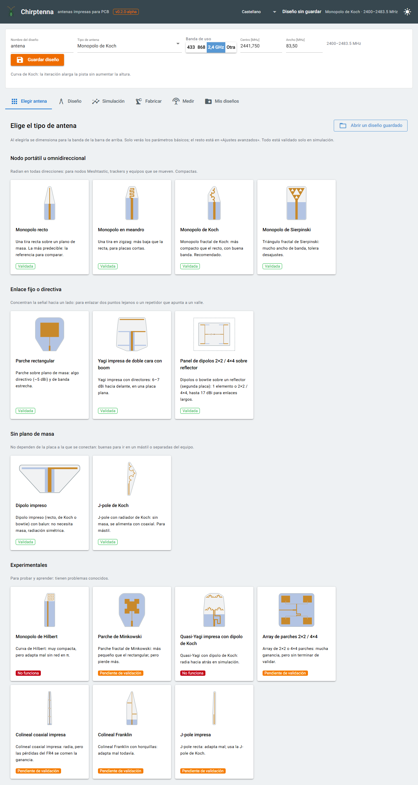
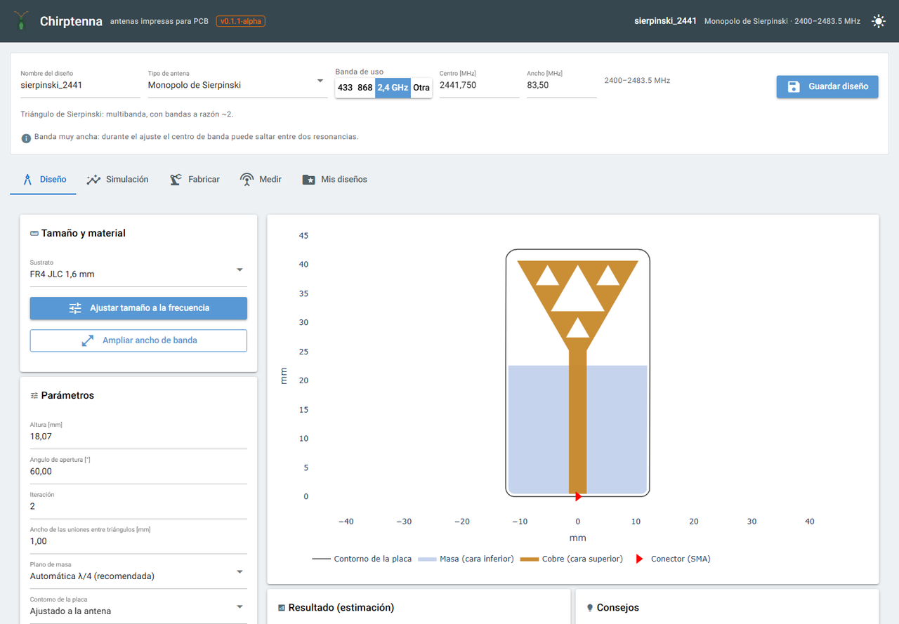
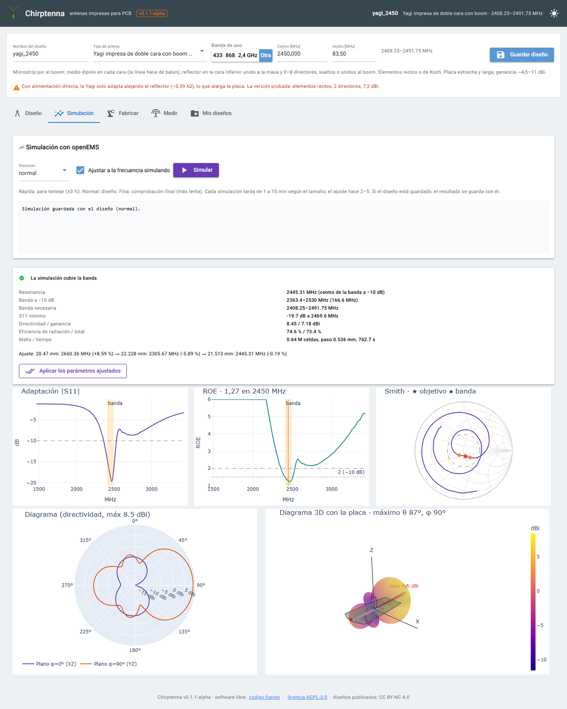
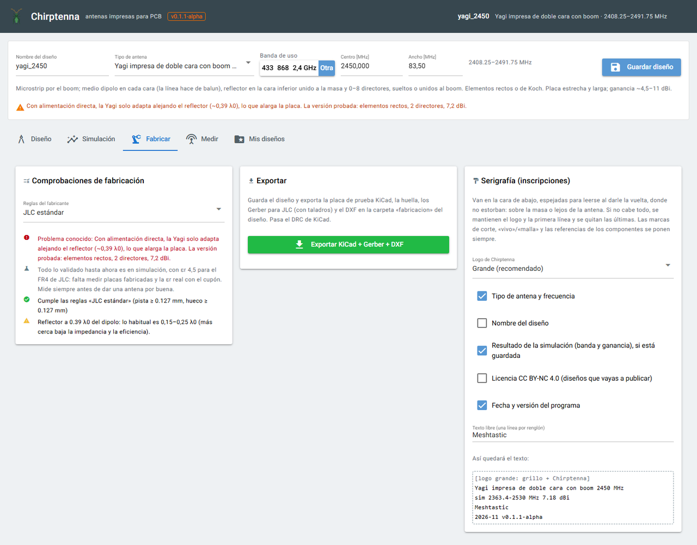
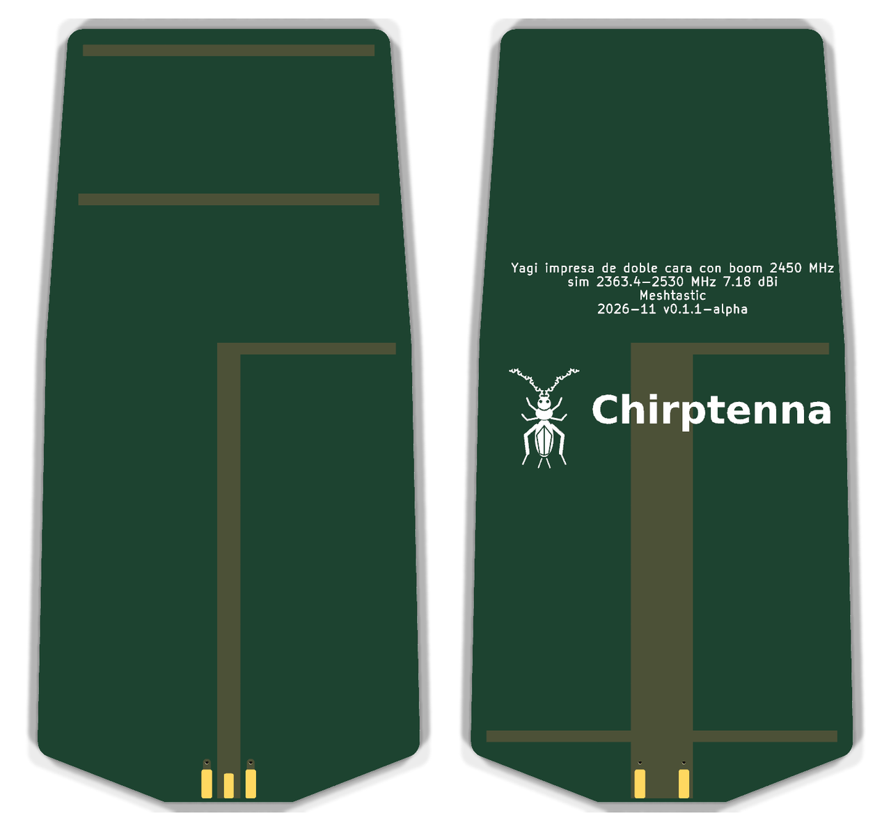
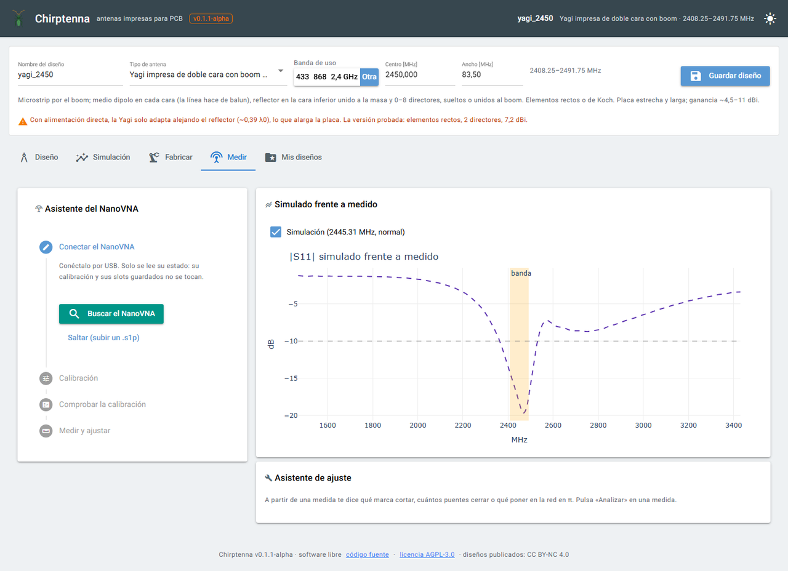

<p align="center"></p>

# Chirptenna: PCB antenna generator

[](https://github.com/sqtactical/chirptenna/actions/workflows/comprobar.yml)

*[Versión en castellano](README.md)*

> **Status: alpha (v0.3.0-alpha).** Validated in simulation only: no manufactured board has been
> measured yet. **Real measurements wanted**: if you build an antenna and measure it, share it with
> the [“Real measurement”](../../issues/new/choose) template. How to contribute: [CONTRIBUTING.md](CONTRIBUTING.md).
> Release notes: [CHANGELOG.md](CHANGELOG.md).

**Chirptenna** (from *chirp*, LoRa's modulation, and *antenna*) is a program that generates **PCB-printed antennas** (fractal, directional and reference designs)
for a target frequency, **tunes them by simulating with openEMS** (FDTD) and **exports them to
KiCad, Gerber and DXF**, ready to manufacture. It has a browser-based GUI and command-line tools.
Aimed at Meshtastic LoRa nodes (433 / 868 MHz) and at 2.4 GHz.

It also includes **NanoVNA-H** control (PC-side calibration and antenna measurement) and
**calibration coupons** to measure the real εr of the FR4, so that simulations match the
manufactured boards.

> **Project status:** everything described here is **simulated, not measured**. Boards have
> been ordered; the εr of JLC's FR4 (4.5 by default) is still to be measured with the coupon.
> Treat it as a work in progress.

> The code and comments are in **Spanish**; the GUI and the web version speak **Spanish, English, French and German** (language selector in the header).

## What it does

1. You pick the antenna type, the band (433, 868, 915 ISM, 1.2 GHz amateur, GPS L1, Iridium, 2.4 GHz, 5.8 GHz or custom; those other than 868 and 2.4 GHz are not simulated, and FR4 is very lossy at 5.8 GHz) and the substrate.
2. The program sizes the antenna with formulas **calibrated against earlier simulations** and
   checks JLC's manufacturing rules.
3. Optionally it **simulates it with openEMS** and adjusts its size until it resonates at the
   requested frequency (S11, Smith chart, radiation pattern, gain and efficiency).
4. It exports it: a KiCad test board with an edge-mount SMA or IPEX, Gerbers and drill files for
   JLC, DXF, and a footprint to embed it in another board. It passes KiCad's DRC and prints the
   Chirptenna logo and the labels you choose on the silkscreen (type and frequency, simulation
   result, licence, date, free text…).
5. It can add **post-manufacture tuning** without components: an overlength with cut marks
   labelled in MHz, and segments closed with solder bridges (or an optional π network).
6. It saves each design in **My designs** (`Documents\Chirptenna\disenos`) with its simulation,
   export and measurements, and a **NanoVNA assistant** walks you through calibrating over the
   antenna's range, checking, measuring (also live while you trim) and what to cut or fit in the
   π network, with the measured curve overlaid on the simulated one.
7. Yagis and the panel can have **lightening cutouts**: FR4-free windows between the copper and the
   edge (not simulated yet: the frequency may rise slightly).
8. **Interface in Spanish, English, French and German** (selector in the header; also in the web lite version).
   Languages are `antenas/idiomas/<code>.json` files: adding one means translating a file.
9. **GPU acceleration** (experimental, NVIDIA cards): with an openEMS build that has the GPU engine, simulations
   run ~10 times faster. Frequency, S11 and impedance match the CPU; gain and efficiency come out a little high, so
   confirm the final design on the CPU. How to build it: [`docs/GPU.en.md`](docs/GPU.en.md) (reconstructed guide, not yet verified from scratch).

## Screenshots

**Choose antenna** (*Elegir antena*): the first thing you see, a gallery of types grouped by use, with a drawing, a description and a status.



**Design** (*Diseño*): pick the type and band; the program sizes the antenna and warns about known issues.



**openEMS simulation** (*Simulación*): S11, VSWR, Smith chart with the band marked, radiation pattern and a
3D pattern with the board inside (here a 2450 MHz Yagi: 7.2 dBi towards the directors).



**Manufacture** (*Fabricar*): JLC rules, KiCad/Gerber/DXF export and the silkscreen labels.



The resulting board (KiCad render): top side and bottom side with the logo and labels.

<p align="center"></p>

**Measure** (*Medir*): NanoVNA assistant (connect, calibrate, check, measure) with the measurement overlaid on the simulation.



## Antenna types

| Type | Family | Simulation status |
|---|---|---|
| Straight, meander and Koch monopoles | monopole | ✅ validated (868 MHz to 5.8 GHz, including 915 ISM, 1.2 GHz, GPS L1 and Iridium) |
| Sierpinski monopole (with «Two bands»: 869 MHz and 2.4 GHz at once, simulation only) | monopole | ✅ validated (868 MHz to 5.8 GHz) |
| Hilbert monopole | monopole | ⚠️ resonates, but does not match without a π network |
| Rectangular patch | patch | ✅ validated (narrowband; at 5.8 GHz with a slot feed: −10.6 dB, η 60 %) |
| Sierpinski arrowhead monopole (a curiosity) | monopole | ✅ validated at 2.4 GHz with iteration 1 (−15.9 dB, η 93 %); iterations 2 and 3 do not match |
| Minkowski patch | patch | ⚠️ iteration 1 fine; iteration 3 has low efficiency on FR4 |
| Circularly polarised patch (cut corners, single feed; GPS, Iridium) | patch | ❌ neither matches nor gives circular polarisation in simulation (−4 to −6 dB, axial ratio ≥ 6 dB) |
| Patch with U-slot | patch | ⚠️ not tested or validated |
| Patch with coupled parasitic (flat alternative to stacked) | patch | ❌ does not match in simulation (−0.6 dB, η 7 %) |
| Inverted-F antenna (F-shaped J-pole) and PIFA | monopole | ✅ validated in simulation (868 MHz, 1.2 GHz, 2.4 and 5.8 GHz) |
| Sleeve dipole | monopole | ✅ validated in simulation (868 MHz to 5.8 GHz) |
| Antipodal Vivaldi | vivaldi | ✅ validated in simulation (2.4 GHz −18 dB and 5.8 GHz −12.3 dB; very wide band) |
| Series dipole collinear (microstrip line) | collinear | ✅ validated in simulation at 2.4 GHz (−12.7 dB, 4.1 dBi, η 59 %) and 5.8 GHz (−13.8 dB, 3.5 dBi, η 50 %); on FR4 the gain falls short |
| Printed dipole (straight or Koch; printed balun or centre-fed coax) | dipole | ✅ validated (868 MHz to 5.8 GHz) |
| Bowtie dipole or Sierpinski bowtie | dipole_bowtie | ✅ validated (868 MHz to 5.8 GHz; marginal at 5.8 GHz); twice the bandwidth of the straight one |
| J-pole and Koch J-pole | jpole | ✅ Koch validated (868 MHz and 1.2 GHz; 2.4 GHz almost, −9 dB); the straight one from 868 MHz to 2.4 GHz (−15 dB at 868 MHz and −12 dB at 2.4 GHz; now the default) |
| Dual-band J-pole (two joined J-poles) and dual-band IFA (868 MHz + 2.4 GHz) | J-pole and IFA, “Bands” option | 🧪 in the interface since 0.3.0; simulation −11 dB in both bands with a 1 mm mesh, but with another mesh the high band drops (−3 to −7 dB): fragile, unmeasured (`antenas/bibanda.py`) |
| Test bench for new topologies (crossed-dipole turnstile for circular polarisation, slot antenna, tri-band IFA) | tools | 🧪 in simulation (`herramientas/topologias.py`); no results yet |
| Double-sided Yagi with boom | yagi | ✅ straight elements (6–9 dBi; 868 MHz, 2.4 and 5.8 GHz); Koch iteration 2 also works at 2.4 GHz (−14.4 dB, beam forward, but 2.6 dBi) |
| Quasi-Yagi with Koch dipole | yagi | ⚠️ experimental |
| 2×2 / 4×4 panel of dipoles, bowties or Sierpinski bowties over a reflector | panel | ✅ 2×2 ≈ 12.1 dBi (dipoles) and 12.6 dBi (Sierpinski), 4×4 ≈ 14.6–16.6 dBi; single element, untuned; at 2.4 GHz −10.1 dB with the reflector at 0.13–0.16 λ and at 5.8 GHz −9.8 dB |
| 2×2 / 4×4 patch array | array | ⚠️ validation not finished |
| Printed coaxial collinear (COCO) | collinear | ❌ does not match well (−4 dB) and η 24–35 % on FR4; not at 868 MHz either |
| Franklin collinear | collinear | ⚠️ matches, but with little bandwidth and ~2.5 dBi |

## ⚠️ Known issues

**Everything validated so far is in simulation**, with εr 4.5 for JLC's FR4. No manufactured board
and no real εr has been measured yet (that is what the coupons are for). Always measure an antenna
before trusting it. The GUI shows these warnings when you pick the type and when you export.

| Type / option | Issue |
|---|---|
| Hilbert monopole | Resonates, but matches very poorly without a π network (−2.7 dB at 2.4 GHz, −4.6 dB at 868 MHz). At 868 MHz each simulation takes over 3 h. |
| Meander monopole | Frequency jumps a few % with small height changes; with a small ground plane it may not reach −10 dB. |
| Monopoles with IPEX | The straight monopole with IPEX matched poorly (−7 dB): the centre-pad transition is under review. Fine with SMA. |
| Rectangular patch | Narrowband on 1.6 mm FR4 (~36 MHz): does not cover the whole 2.4 GHz ISM band. η ~47 %. At 5.8 GHz with a slot feed it does match the whole band (−10.6 dB, η 60 %). |
| Circular patch | Does not reach −10 dB (best −4.4 dB on RO4350B at GPS L1 and −5.9 dB at 2.4 GHz) and the axial ratio never drops below 6 dB; on FR4 η 4–44 %. The diagonal sets the rotation sense. Do not use it for GPS. |
| Minkowski patch | Iteration 1: η ~33 % and ~1 dBi. Iteration 3: it matches (−17.5 dB) but η ~30 % and < 1 dBi. |
| Straight J-pole | With the wider gap and the tap at 26 % (default since 0.3.0) it matches at 868 MHz (−15 dB), 915 MHz (−10 dB), 1.2 GHz (−9.7 dB), GPS L1 (−11.8 dB) and 2.4 GHz (−12 dB); at 5.8 GHz it does not (−6.5 dB; the real part stays at ~20 Ω). The Koch J-pole matches at 868 MHz (−17 to −20 dB), 1.2 GHz (−10.6 dB) and almost at 2.4 GHz (−9 dB). |
| Yagi with boom, Koch elements | Iteration 1 at 2.4 GHz: the configuration that matches (−21 dB) radiates backwards. Iteration 2 works (−14.4 dB, beam forward, η 81 %) but with only 2.6 dBi: straight elements give more gain. |
| Yagi with boom, folded dipole | Radiates backwards (F/B −3.6 dB). Use direct feed (reflector at ~0.39 λ0, longer board). |
| Yagi with boom, λ/4 transformer | Narrow band (~50 MHz) and η ~55 %. |
| Koch quasi-Yagi | Radiates backwards and matches poorly (−3.5 dB). Experimental. |
| Dipole panel | The tuning does not iterate the frequency (rippled S11): the initial size is calibrated with the 2×2 at 2.4 GHz. With a fine mesh the beam comes out straight ahead (0–3°). The single-element panel resonates far from the target. The “symmetric” layout worsens the match. |
| Patch array | Validation not finished: the 2×2 resonates 16 % low with the default size, η ~22 % and each simulation takes hours. |
| Dipole collinear | At 2.4 GHz −12.7 dB (η 59 %); at 5.8 GHz −13.8 dB with 4 elements, line factor 1.1 and arm width ×1.05 (η 50 %). Shortening the lines by 10 % is no longer needed. |
| COCO collinear | Radiates, but FR4 losses leave η ~53 % and ~1.9 dBi at 2.4 GHz; at 868 MHz, η 26 %, −2 dBi and S11 −7.8 dB. |
| Franklin collinear | Matches (−19 dB at 2.4 GHz, −35 dB at 868 MHz) but with 62 and 23 MHz of bandwidth and 2.2–2.8 dBi. Experimental. |
| Lightening cutouts | Yagi with boom: at 868 MHz and 5.8 GHz they hardly change anything (−8.6 and −12.0 dB); at 2.4 GHz with the default margin the match drops to −2.3 dB and the beam flips (with a 6 mm margin, −6.0 dB and beam forward). Panel at 2.4 GHz: −7.8 dB. Simulate before manufacturing. |
| Other bands | GPU campaign of 6–7 Nov (`docs/desarrollo/barridos_gpu.md`): monopoles, dipoles, bowtie and sleeve work from 868 MHz to 5.8 GHz (most also at 915 ISM, 1.2 GHz, GPS L1 and Iridium); IFA and PIFA at 868 MHz, 2.4 and 5.8 GHz; Vivaldi at 2.4 and 5.8 GHz. Panel, collinears, patches and array do not match outside the bands tested. 7–8 Nov batch (`docs/desarrollo/resultados_07-11.md`): the straight J-pole at 868 MHz, the Koch J-pole at 1.2 GHz, the slot-fed patch at 5.8 GHz and the dipole collinear at 2.4 and 5.8 GHz reach −10 dB, and so do the IFA, PIFA and dipole at 1.2 GHz (−14 dB), the bowtie at 2.4 and 5.8 GHz, the sleeve and Vivaldi at 5.8 GHz, the IPEX monopole at 2.4 GHz (manual ground) and the iteration-1 Sierpinski arrowhead; dual-band 868 MHz + 2.4 GHz: two joined J-poles (−11.2 and −10.6 dB) and an IFA with a second branch (−11.7 and −10.8 dB), simulation only. |

## Requirements

- 64-bit **Windows 10/11** (development platform; the code only depends on it for default paths).
- **Python 3.13 or 3.14** (openEMS 0.37 wheels only exist for those versions).
- **openEMS v0.37** with its Python wheels (`openEMS`, `CSXCAD`).
- **KiCad 8 or later** (`kicad-cli`, tested with 10) to produce Gerbers and run the DRC. Without
  it, the `.kicad_pcb` and DXF are still exported, but not the Gerbers.
- Optional: a **NanoVNA-H** (DiSlord firmware) for measurements.

## Try it without installing

**[Chirptenna web lite](https://sqtactical.github.io/chirptenna/)** (Spanish, English, French and German): design the antenna in
your browser and download it for **KiCad** (`.kicad_pcb`, footprint, DXF and `diseno.json`). Everything runs in your
browser (Python via Pyodide); nothing is sent to any server. It doesn't simulate or run KiCad's DRC: open the board
in KiCad, run its DRC and plot the Gerbers there (the zip includes a README with the steps). To simulate and measure,
install the application.

## Installation

**No Python knowledge needed:** download the ZIP of the latest version from
[Releases](https://github.com/sqtactical/chirptenna/releases), double-click **`instalar.bat`**, then open the
program with the desktop shortcut or **`iniciar.bat`**. The installer downloads Python and openEMS
from their official sites (checking the signature and SHA-256), creates the environment and installs
the packages, without administrator rights. Step-by-step guide, troubleshooting, uninstalling and
manual installation: **[INSTALL.en.md](INSTALL.en.md)**.

**User manual:** **[MANUAL.en.md](MANUAL.en.md)** (Spanish original: [MANUAL.md](MANUAL.md)). It covers every tab, measuring
with the NanoVNA and tuning the manufactured antenna (cut marks, solder bridges and the **π network**, with
worked examples and which components to buy).

## Usage

**GUI** (http://localhost:8080):

```bash
%LOCALAPPDATA%\antenas\venv\Scripts\python.exe gui/app.py
```

The tabs follow the workflow: **Design → Simulation → Manufacture → Measure → My designs** (the
interface is in Spanish). Set `CHIRPTENNA_DISENOS` to store designs elsewhere.

**Simulate and tune several designs from the command line**:

```bash
python -m antenas.validar_lote salidas/lote --malla adaptada --hilos 6 monopolo_recto:866.5:normal "dipolo:2441.75:normal:{\"alimentacion\":1}"
```

**Simulation queue** (at most two workers at once):

```bash
python herramientas/cola.py añadir my_job python -m antenas.validar_lote salidas/lote monopolo_koch:2441.75:normal
```

```bash
python herramientas/cola.py trabajar --hilos 6
```

**Recalibrate the estimates** with every simulation done so far:

```bash
python herramientas/calibrar_estimaciones.py
```

**Generate the εr calibration coupons**:

```bash
cd cupon && python generar_cupon.py
```

Simulations are slow: from minutes (2.4 GHz monopoles) to hours (arrays, or anything at 868 MHz
with thin traces). They are cached in `%TEMP%\antenas_sim`.

## Layout

| Folder | Contents |
|---|---|
| `antenas/` | Main package: catalogue (`tipos`), geometry, generators, openEMS simulation, tuning, export, design tips |
| `gui/` | NiceGUI interface |
| `vna/` | NanoVNA control, PC calibration and measurements |
| `cupon/` | εr coupon generator and ring simulations |
| `fase0/` | Initial openEMS validation (dipole and monopole) |
| `referencias/` | Models of commercial antennas, to compare simulation and measurement |
| `herramientas/` | Simulation queue, estimate calibration, diagnostics |
| `analisis/`, `placa_sim/` | Tools to study existing boards from their Gerbers |
| `docs/logo/` | Logo (a cricket with Koch-curve antennae) and the script that draws it |

`salidas/` (exports), `placas/` (third-party Gerbers) and the generated coupons are not in the
repository: they are regenerated with the program.

## Licence

- **Code:** [GNU AGPL v3.0](LICENSE) (v0.1.0-alpha was released under GPL v3.0; later versions, under AGPL).
  You may use, modify and sell it, but if you distribute a modified version **or offer it as a network
  service**, you must publish its source code under the same licence.
- **Designs published by the author** (exported antennas and coupons): [CC BY-NC 4.0](LICENSE-DISENOS.md).
- Designs you generate yourself with the program are yours.
