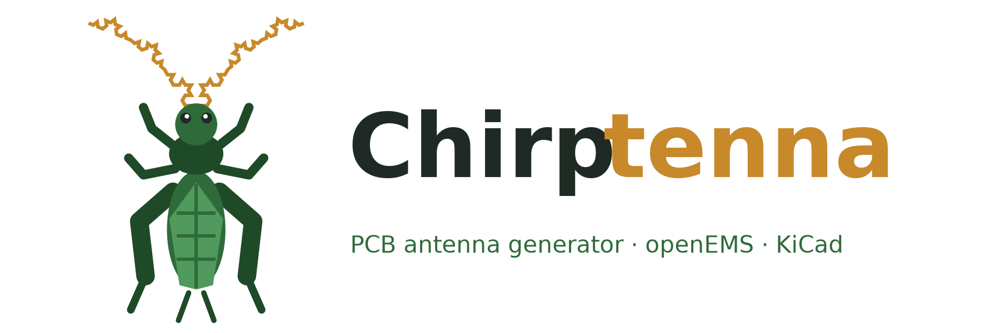

<p align="center"></p>

# Chirptenna: generador de antenas para PCB

*[English version](README.en.md)*

**Chirptenna** (de *chirp*, la modulación de LoRa, y *antenna*) es un programa que genera **antenas impresas en PCB** (fractales, directivas y de referencia) para una
frecuencia objetivo, las **ajusta simulándolas con openEMS** (FDTD) y las **exporta a KiCad,
Gerber y DXF** listas para fabricar. Tiene interfaz gráfica en el navegador y herramientas de
línea de comandos. Pensado para los nodos LoRa de Meshtastic (433 / 868 MHz) y para 2,4 GHz.

Incluye además el control de un **NanoVNA-H** (calibración en el PC y medida de antenas) y unos
**cupones de calibración** para medir la εr real del FR4, de modo que la simulación coincida con
las placas fabricadas.

> **Estado del proyecto:** todo lo que se indica aquí está **simulado, no medido**. Las placas
> están pedidas; la εr del FR4 de JLC (4,5 por defecto) está pendiente de medir con el cupón.
> Trátalo como un proyecto en desarrollo.

## Qué hace

1. Eliges el tipo de antena, la banda (433, 868, 2,4 GHz u otra) y el sustrato.
2. El programa dimensiona la antena con fórmulas **calibradas con simulaciones anteriores** y
   comprueba las reglas de fabricación de JLC.
3. Opcionalmente la **simula con openEMS** y ajusta su tamaño hasta que resuena en la frecuencia
   pedida (S11, carta de Smith, diagrama de radiación, ganancia y eficiencia).
4. La exporta: placa de prueba de KiCad con SMA de canto o IPEX, Gerber con taladros para JLC,
   DXF y huella para usarla dentro de otra placa. Pasa el DRC de KiCad y rotula la serigrafía.
5. Puede añadir **ajuste tras fabricar** sin componentes: sobrelargo con marcas de corte rotuladas
   en MHz y tramos que se cierran con un puente de estaño (o red en π opcional).

## Tipos de antena

| Tipo | Familia | Estado en simulación |
|---|---|---|
| Monopolo recto, meandro, Koch | monopolo | ✅ validados (2,4 GHz y 868 MHz) |
| Monopolo de Sierpinski | monopolo | ✅ validado (2,4 GHz) |
| Monopolo de Hilbert | monopolo | ⚠️ resuena, pero sin red en π no adapta |
| Parche rectangular | parche | ✅ validado (banda estrecha) |
| Parche de Minkowski | parche | ⚠️ iteración 1 bien; la 3 tiene poca eficiencia en FR4 |
| Dipolo impreso (balun impreso o coaxial al centro) | dipolo | ✅ validado (2,4 GHz) |
| J-pole y J-pole de Koch | jpole | ✅ Koch validada; la recta, en revisión |
| Yagi con boom (doble cara) | yagi | ✅ elementos rectos (6–7 dBi); con Koch, experimental |
| Quasi-Yagi con dipolo de Koch | yagi | ⚠️ experimental |
| Panel de dipolos 2×2 / 4×4 sobre reflector | panel | ✅ 2×2 ≈ 12,7 dBi, 4×4 ≈ 16,6 dBi |
| Array de parches 2×2 / 4×4 | array | ⚠️ sin terminar de validar |
| Colineal coaxial impresa (COCO) | colineal | ⚠️ radia, pero las pérdidas del FR4 se comen la ganancia |
| Colineal Franklin | colineal | ⚠️ experimental |

Los detalles de cada simulación y los errores encontrados por el camino están en
[`CLAUDE.md`](CLAUDE.md) (lecciones aprendidas) y [`RETOMAR.md`](RETOMAR.md) (estado).

## Requisitos

- **Windows** (es donde se ha desarrollado; el código no depende de él salvo las rutas por defecto).
- **Python 3.12 o posterior** (desarrollado con 3.14).
- **openEMS v0.37** con sus wheels de Python (`openEMS`, `CSXCAD`).
- **KiCad 10** (`kicad-cli`) para generar los Gerber y pasar el DRC. Sin él se exportan el
  `.kicad_pcb` y el DXF, pero no los Gerber.
- Opcional: un **NanoVNA-H** (firmware DiSlord) para medir.

## Instalación

Crea el entorno virtual **fuera de una ruta larga** (en OneDrive o carpetas profundas Windows
supera los 260 caracteres y fallan las DLL de shapely):

```bash
python -m venv %LOCALAPPDATA%\antenas\venv
```

```bash
%LOCALAPPDATA%\antenas\venv\Scripts\python.exe -m pip install -r requirements.txt
```

```bash
%LOCALAPPDATA%\antenas\venv\Scripts\python.exe -m pip install --no-index --find-links %LOCALAPPDATA%\Programs\openEMS\openEMS\python openEMS
```

## Uso

**Interfaz gráfica** (http://localhost:8080):

```bash
%LOCALAPPDATA%\antenas\venv\Scripts\python.exe gui/app.py
```

**Simular y ajustar varios diseños desde la línea de comandos** (resultados en la carpeta indicada):

```bash
python -m antenas.validar_lote salidas/lote --malla adaptada --hilos 6 monopolo_recto:866.5:normal "dipolo:2441.75:normal:{\"alimentacion\":1}"
```

**Cola de simulaciones** (dos trabajadores a la vez como máximo):

```bash
python herramientas/cola.py añadir mi_trabajo python -m antenas.validar_lote salidas/lote monopolo_koch:2441.75:normal
```

```bash
python herramientas/cola.py trabajar --hilos 6
```

**Recalibrar las estimaciones** con todas las simulaciones hechas:

```bash
python herramientas/calibrar_estimaciones.py
```

**Generar los cupones de calibración de εr**:

```bash
cd cupon && python generar_cupon.py
```

Las simulaciones son lentas: de minutos (monopolos a 2,4 GHz) a horas (arrays, o cualquier cosa a
868 MHz con pistas finas). Se guardan en caché en `%TEMP%\antenas_sim`.

## Estructura

| Carpeta | Contenido |
|---|---|
| `antenas/` | Paquete principal: catálogo (`tipos`), geometría, generadores, simulación con openEMS, ajuste, exportación, consejos |
| `gui/` | Interfaz NiceGUI |
| `vna/` | Control del NanoVNA, calibración en el PC y medidas |
| `cupon/` | Generador de cupones de εr y simulación de sus anillos |
| `fase0/` | Validación inicial de openEMS (dipolo y monopolo) |
| `referencias/` | Modelos de antenas comerciales para comparar simulación y medida |
| `herramientas/` | Cola de simulaciones, calibración de estimaciones, diagnósticos |
| `analisis/`, `placa_sim/` | Herramientas para estudiar placas existentes a partir de sus Gerber |
| `docs/logo/` | Logo (un grillo con antenas de Koch) y el script que lo genera |

`salidas/` (exportaciones), `placas/` (Gerber de terceros) y los cupones generados no están en el
repositorio: se regeneran con el programa.

## Licencia

- **Código:** [GNU GPL v3.0](LICENSE).
- **Diseños publicados por el autor** (antenas y cupones exportados): [CC BY-NC 4.0](LICENSE-DISENOS.md).
- Los diseños que generes tú con el programa son tuyos.
